<div align="center">

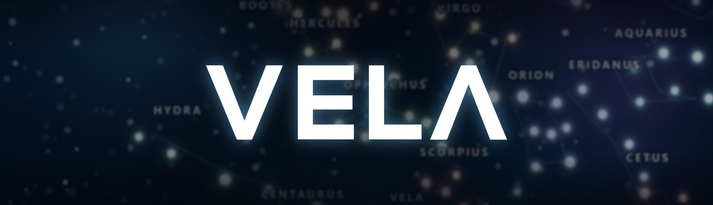

### Find the dark. Read the sky.

VELA is a stargazing atlas for the whole planet. Drop a pin anywhere and it tells
you how dark the sky is there, which planets are up, and where the nearest truly
dark ground is. Then it walks you through tonight's Moon, the constellations and
the solar system in 3D.


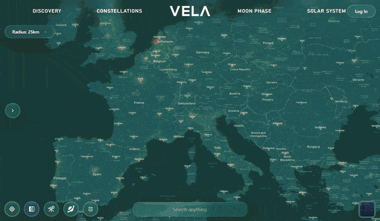

<i>Recorded straight from the running app (sped up to fit): light map, 3D city, Moon, constellations, solar system.</i>

</div>

---

## What it is

At its core, VELA is a world map connected to the **World Atlas 2015**, a ~3 GB
GeoTIFF of artificial night-sky brightness for every point on Earth. The
ASP.NET Core API reads that raster directly. It turns any coordinate into an
**SQM** reading and a **Bortle class**, scans a radius for the darkest reachable
land, and renders the planet's light pollution as map tiles, one pixel at a time.

The React frontend adds live visible-planet data, curated dark-sky sites,
community star parties and special events, an AR planet finder for phones, and
three WebGL experiences: the Moon, the constellations and the solar system.
Accounts unlock favorites, RSVPs and a profile; admins get a workspace for
curating everything on the map.

The stack is React 19 + Vite on the front and ASP.NET Core 9 + SQL Server
stored procedures on the back, with JWT auth throughout.

## The map

<div align="center">
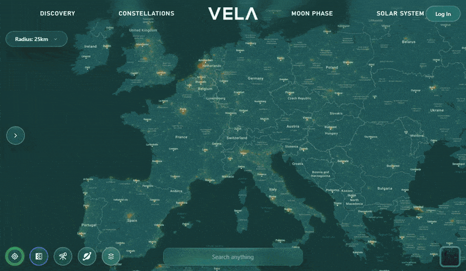
<br>
<i>The light-pollution layer, rendered by VELA's own API from the GeoTIFF as you
fly. Green is dark sky; orange and red are city glow.</i>
<br><br>
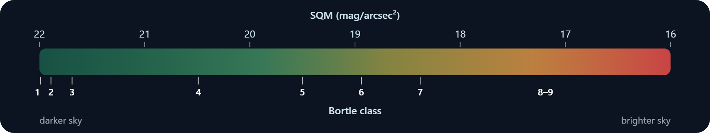
</div>

<table>
<tr>
<td width="50%">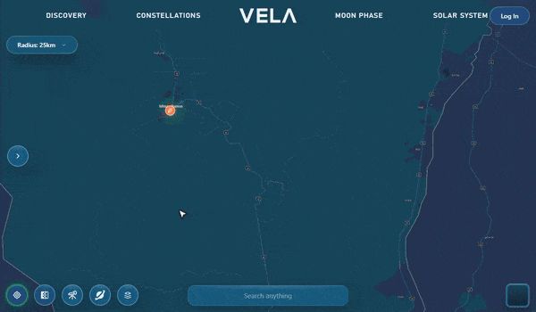</td>
<td width="50%">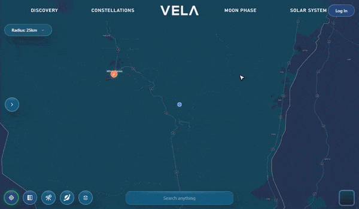</td>
</tr>
<tr>
<td align="center"><b>Drop a pin, read the sky.</b> Double-click anywhere
(long-press on a phone) for its Bortle class, SQM, brightness and glow ratio.
<b>Planets</b> then slides in the planets visible from that spot as live 3D
globes; hover one for altitude, azimuth, magnitude and RA/Dec.</td>
<td align="center"><b>Stargaze.</b> One tap scans your radius for the darkest
land nearby and drops up to 12 well-spaced candidates. Each opens with its own
reading, so you can compare before you drive.</td>
</tr>
<tr>
<td width="50%">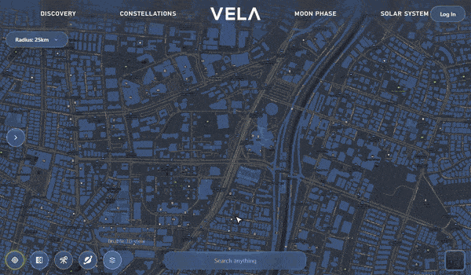</td>
<td width="50%">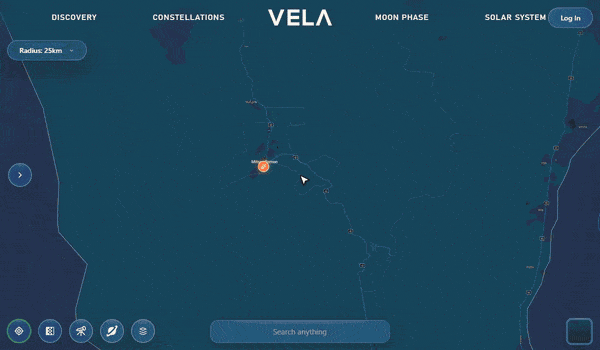</td>
</tr>
<tr>
<td align="center"><b>3D mode.</b> MapLibre GL runs inside Leaflet with
extruded buildings and a 58° tilt. Hold both mouse buttons and drag to change
the angle.</td>
<td align="center"><b>Three base maps.</b> Dark, light and satellite. The
whole glass UI re-tints to match, turning warm gold over satellite imagery so
it stays readable.</td>
</tr>
<tr>
<td width="50%">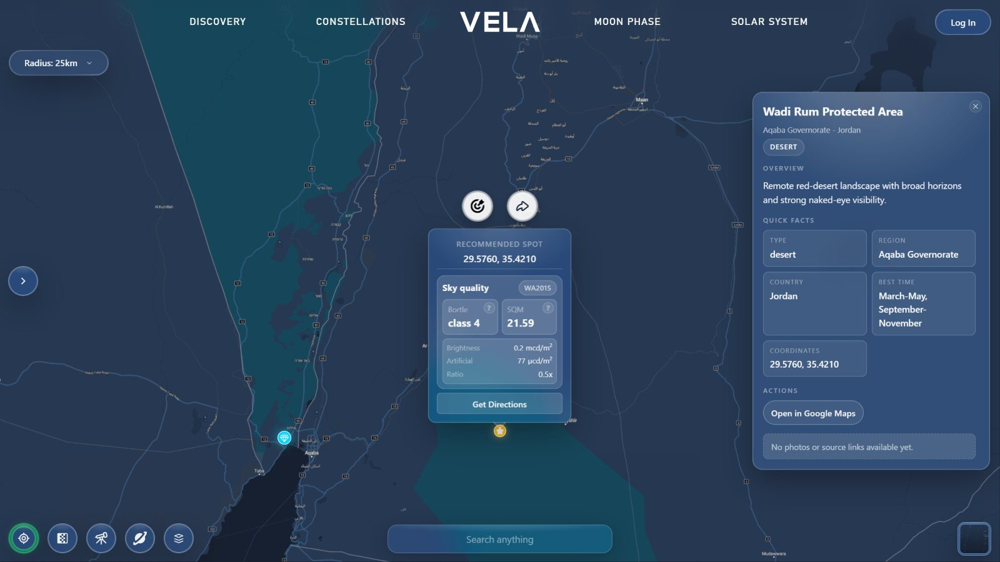</td>
<td width="50%">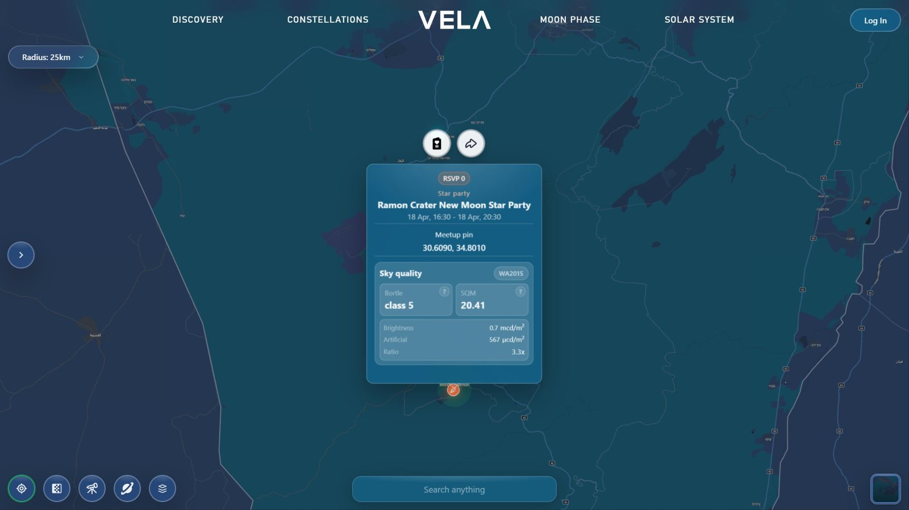</td>
</tr>
<tr>
<td align="center"><b>Curated dark-sky sites.</b> Hand-picked locations from
Wadi Rum to Mauna Kea, each with a details panel, the best season to go and
one-tap directions through Google Maps or Waze.</td>
<td align="center"><b>Star parties and special events.</b> Published events get
their own markers (a party horn for star parties, a separate icon for special
events) with a schedule, the sky at the venue and an RSVP count. Signed-in users
can RSVP with one tap.</td>
</tr>
</table>

Every popup also lets you **copy the coordinates** with a click, **share** the
spot (it opens in Google Maps), and **set it as the target** for the Planets
and Stargaze buttons. Search takes raw coordinates (`30.61, 34.80`), curated
spot names or event titles. Leaving the map zooms it out before the next page
loads, and small toasts confirm what just happened.

## Beyond the map

<table>
<tr>
<td width="50%">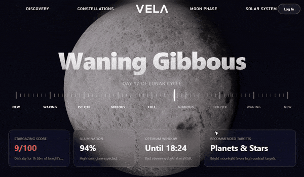</td>
<td width="50%">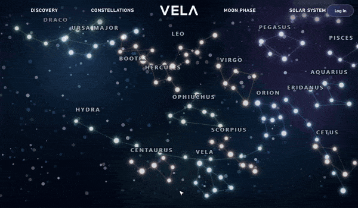</td>
</tr>
<tr>
<td align="center"><b>Moon Phase.</b> Drag the ruler to preview any night of
the lunar cycle. The ticks magnify around the handle, the 3D Moon relights,
and the stargazing score, illumination, moon-free window and suggested targets
all recompute. <b>Reset to Current</b> snaps back to tonight.</td>
<td align="center"><b>Constellations.</b> An interactive chart of 18
constellations. Hover to light one up; click for a panel with its region, best
months, star and line counts, what it's known for, and its named stars. Vela,
the sail of Argo, is the one the app is named after.</td>
</tr>
<tr>
<td width="50%">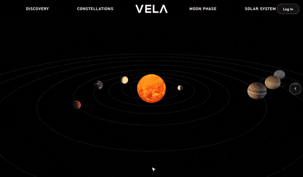</td>
<td width="50%">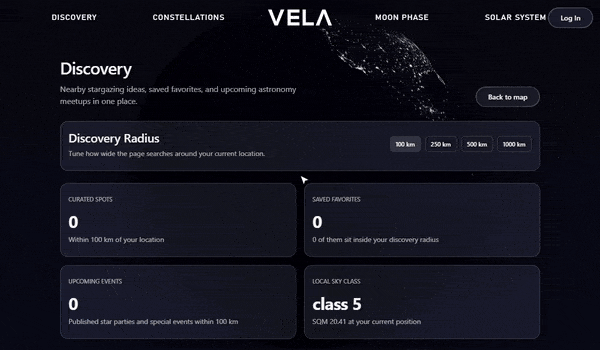</td>
</tr>
<tr>
<td align="center"><b>Solar System.</b> The Sun and eight planets orbiting in
Three.js with real textures. Pick a body to fly the camera to it and read its
distance, day, year, moons and temperature. Orbit pace and orbit trails are one
slider and one toggle away.</td>
<td align="center"><b>Discovery.</b> Everything near you in one place, within a
radius of 100 to 1,000 km: curated spots, your favorites, star parties and
special events, and <b>Tonight's Local Sky</b>, which spells out what your
current sky is good for and lists darker escapes nearby.</td>
</tr>
</table>

## Your account

<table>
<tr>
<td width="50%">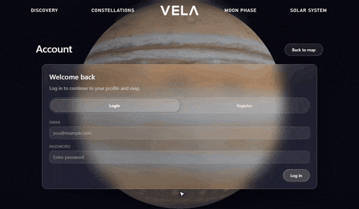</td>
<td width="50%">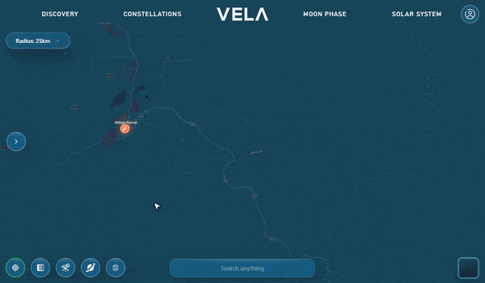</td>
</tr>
<tr>
<td align="center"><b>Sign up.</b> The password checklist ticks off each rule
as you type: 8+ characters, upper and lower case, a number and a symbol.</td>
<td align="center"><b>Favorites.</b> Heart any pin or spot to save it, then
rename it inline. Favorites follow you to Discovery, where VELA enriches them
with curated-spot details when the coordinates match.</td>
</tr>
</table>

A **profile** page holds your display name, avatar and bio, and **settings**
cover directions provider, default map style, search radius, location accuracy
and accessibility (see [Settings](#settings)).

## Admin workspace

<div align="center">
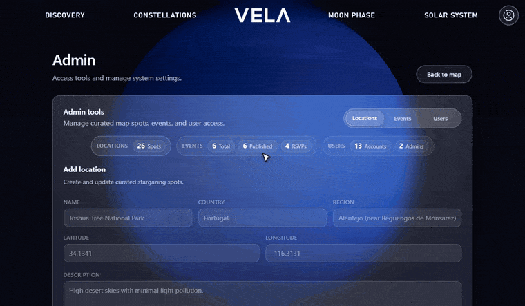
</div>

Admins get a workspace with live counts (spots, events, RSVPs, accounts, admins)
and three tabs:

- **Locations.** Add or edit curated spots: name, country, region, type, best
  season, coordinates, description, and photo and source links.
- **Events.** Create star parties or special events with a sliding type switch,
  a Draft / Published / Archived status, a custom calendar and a scroll-wheel
  time picker. Advanced details hold the end time, meetup notes and a host
  checklist. Existing events can be searched, edited, set back to draft or
  removed. Only published events reach the map.
- **Users.** Promote or demote admins.

## In your pocket

<table>
<tr>
<td width="34%" align="center">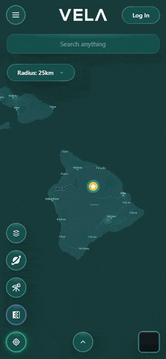</td>
<td width="66%">

**AR planet finder.** Open the planets sheet, swipe to a planet, and tap **AR**.
The camera opens with a guide on top. VELA reads your compass heading and tilt
from the phone's orientation sensors, compares them with the planet's azimuth
and altitude, and tells you how far to turn and tilt ("Turn right 16° and tilt
up 9°"). Within 6° on both axes, the planet sits on the center marker.

Camera access needs HTTPS, so test it through a tunnel (see
[Testing on a phone](#testing-on-a-phone)).

<sub>Recorded in a headless browser at Mauna Kea after midnight: the camera feed
is a stand-in starfield and the phone's movement is simulated, so what you see
is the real overlay reacting to those readings.</sub>

</td>
</tr>
</table>

Phones get their own layouts throughout: bottom-sheet planet cards, stacked
quick actions, long-press to pin, and a hamburger menu.

<table>
<tr>
<td align="center">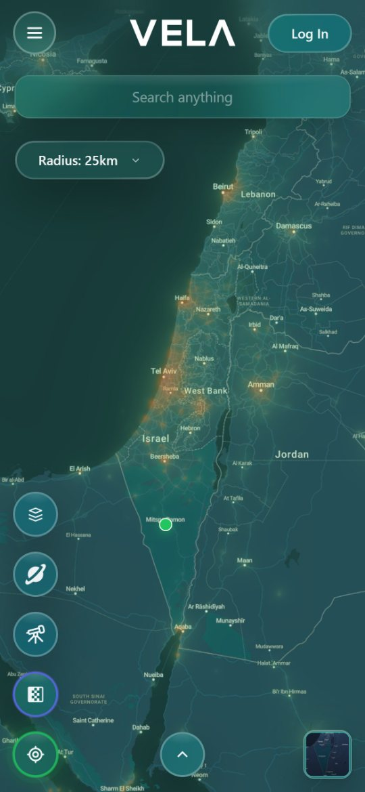</td>
<td align="center">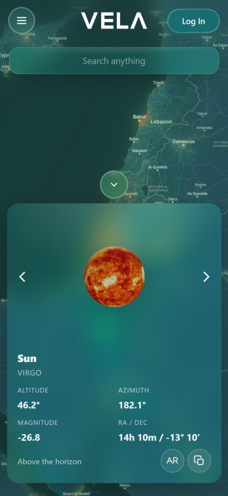</td>
<td align="center">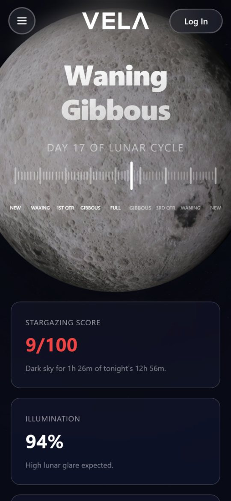</td>
<td align="center">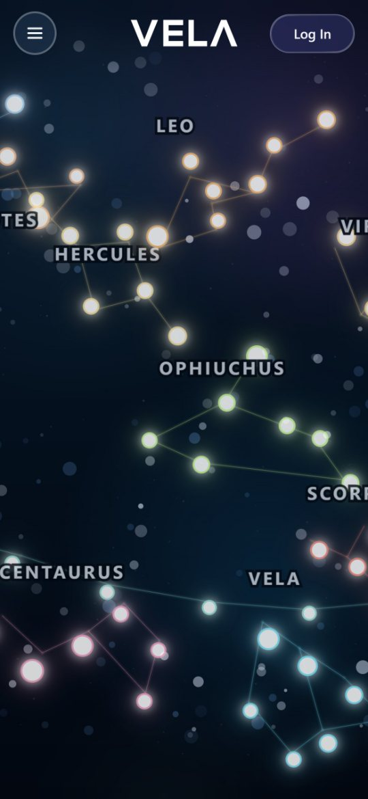</td>
<td align="center">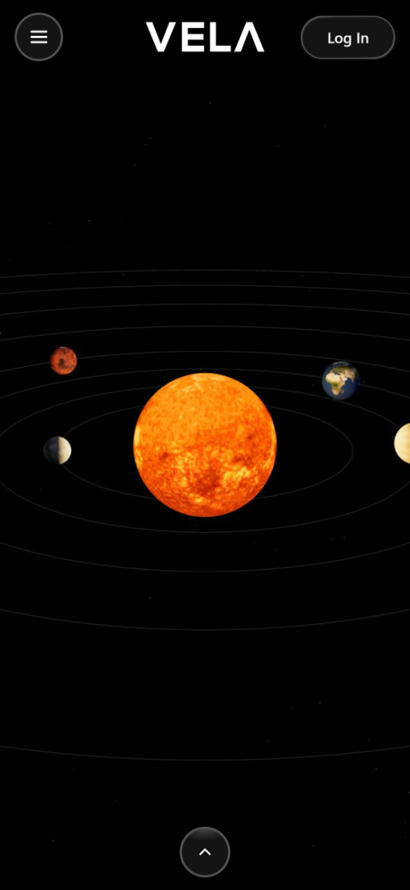</td>
</tr>
</table>

## How it works

Each part folds open: the math behind the sky readings, the dark-spot search,
the tile renderer, and the Moon planner.

<details>
<summary><b>From a pixel to a Bortle class (sky quality)</b></summary>
<br>

```text
lat/lon ─▶ GeoTIFF pixel ─▶ artificial brightness ─▶ + natural sky ─▶ SQM ─▶ Bortle class
```

1. **Find the pixel.** `AtlasMetadata.ToPixel` uses the GeoTIFF's tie point and
   pixel scale: `x = ⌊(lon − minLon) / xRes⌋`, `y = ⌊(maxLat − lat) / yRes⌋`.
2. **Read only what's needed.** `RasterSampler` decodes just the internal TIFF
   tile that holds the pixel and caches decoded tiles for the rest of the
   request. The 3 GB file is never loaded whole.
3. **Convert to SQM.** The raster stores artificial brightness in mcd/m². VELA
   adds the natural sky background (0.171168 mcd/m²) and converts to surface
   brightness:

   ```text
   SQM = −2.5 · log10( (artificial + 0.171168) / 108,000,000 )      [mag/arcsec²]
   ```

   This is the standard `−2.5 · log10(L / 108,000)` with `L` in cd/m².
4. **Classify.** The SQM maps onto the Bortle scale:

   | SQM ≥ | Bortle class | Typical sky |
   | ----- | ------------ | ----------- |
   | 21.99 | 1 | Excellent dark site |
   | 21.89 | 2 | Truly dark |
   | 21.69 | 3 | Rural |
   | 20.49 | 4 | Rural/suburban transition |
   | 19.50 | 5 | Suburban |
   | 18.94 | 6 | Bright suburban |
   | 18.38 | 7 | Suburban/urban transition |
   | lower | 8-9 | City |

**Worked example.** At the Ramon Crater star-party meetup (30.609, 34.801),
the artificial brightness is 0.567 mcd/m². Adding the natural sky gives 0.738,
which is **SQM 20.41, class 5**, a sky 3.3× brighter than natural. A pin about
16 km away in open desert reads **SQM 21.82, class 3**, at 0.2× natural.

A raw response from `GET /api/skyquality?lat=30.6&lon=34.8`:

```json
{ "Coordinates": [30.6, 34.8], "SQM": 20.69, "Brightness_mcd_m2": 0.6,
  "Artif_bright_uccd_m2": 401, "Ratio": 2.3, "Bortle": "class 4" }
```

</details>

<details>
<summary><b>Finding the darkest land nearby (dark-spot search)</b></summary>
<br>

`GET /api/darkspots?lat&lon&searchDistance` clamps the radius to 1-250 km. The
map offers 10, 25, 50, 75 or 100 km.

1. **Bound it.** The radius becomes a lat/lon box: 110.574 km per degree of
   latitude, `111.32 · cos(lat)` km per degree of longitude (floored at 0.2
   near the poles). The box is clipped to the raster.
2. **Sample it.** `stride = max(1, ⌊√(width · height / 9000)⌋)`, so a search
   never reads more than about 9,000 pixels, however large the radius.
3. **Filter.** Each sample must fall inside the actual circle (Haversine
   distance), on land (Natural Earth land mask), and in the same country as
   the search origin.
4. **Rank.** Darkest first, with ties going to the closer spot.
5. **Spread out.** Spots are kept greedily if they're at least
   `max(3 km, radius / 8)` apart, up to 12. If fewer than 3 survive, the rules
   relax step by step: separation drops through 2.5, 2, 1.5 and 1 km, and the
   coastline buffer through 0.01°, 0.005° and 0°.

For searches that start in Israel, an extra exclusion buffer along the
Israel/Palestine boundary geometry (0.15°, relaxed down to 0.02°) keeps
suggestions inside the origin country.

</details>

<details>
<summary><b>Painting the planet's light pollution (lightmap tiles)</b></summary>
<br>

`GET /api/lightmap/{z}/{x}/{y}.png`:

1. `TileBounds.FromXyz` turns the Web Mercator tile address into lat/lon
   bounds.
2. Tiles outside the raster get a pre-encoded transparent PNG.
3. Each of the 256 × 256 output pixels goes from pixel to lat/lon to a
   fractional raster position. It's then **bilinear-sampled** from the four
   neighbouring cells (falling back to the nearest valid cell at NoData edges),
   converted to SQM, and coloured.
4. The colour comes from clamping SQM to 16-22, normalising it, and
   interpolating through five RGBA stops from green to yellow to orange to red.
   Alpha rises from 70 to 220, so dark areas barely tint the map and cities
   glow.
5. ImageSharp encodes the PNG with `Cache-Control: public, max-age=3600`, and
   Leaflet draws the layer at 72% opacity above the base map.

</details>

<details>
<summary><b>Tonight's observing plan (Moon Phase)</b></summary>
<br>

All of it lives in `src/pages/MoonPhase/`, with no astronomy library:

- **Positions.** Low-precision orbital formulas from J2000. The Sun's mean
  anomaly is `357.5291° + 0.98560028°/day` and the Moon's mean longitude is
  `218.316° + 13.176396°/day`. Both are rotated to equatorial coordinates with
  an obliquity of 23.4397°.
- **Phase.** Based on a synodic month of 29.530588853 days. The four primary
  phases get a ±1.5% window, and everything in between is a crescent or
  gibbous.
- **Night.** From sunset to sunrise, using the standard −0.833° solar altitude.
- **Moon-free time.** The intervals of the night when the Moon is below the
  horizon.
- **Score.** `round(moonFreeFraction × 60 + (100 − illumination%) × 0.4)`,
  clamped to 0-100. 75+ is Excellent, 50+ Good, 25+ Fair, and anything lower
  is Poor.
- **Targets.** At least 65% moon-free with at most 45% illumination suggests
  **Deep-Sky Objects**. At least 35% moon-free, or at most 65% illumination,
  suggests **Clusters & Nebulae**. Otherwise it's **Planets & Stars**.

On the night these clips were recorded, the Moon was 94% lit and the sky was
dark for 1 h 26 m of a 12 h 56 m night. That works out to 0.11 × 60 + 6 × 0.4 ≈
**9/100**, so the target was Planets & Stars.

</details>

<details>
<summary><b>Tonight's Local Sky (Discovery)</b></summary>
<br>

Discovery reads the sky at your position and turns it into advice:

- **Your sky class** with a plain-language verdict (for example, Bortle 4-5 is
  "Rural to suburban transition"), the glow ratio, and artificial and total
  brightness.
- **Best tonight for**, plus what will struggle. Darker classes suggest
  galaxies, nebulae and wide-field Milky Way shots; brighter ones steer you to
  the Moon, planets and bright star patterns.
- **Nearest improvement.** The darkest spot the search found around you, with
  its distance and how many Bortle classes darker it is ("Nearest darker
  option: Bortle 2").
- **Darker escapes nearby.** A list of those spots, each with its SQM,
  distance and an **Open Map** button.

Curated spots and events are ranked by distance within the chosen radius. If
nothing falls inside it, the closest six are shown instead so the page is never
empty.

</details>

<details>
<summary><b>Visible planets and caching</b></summary>
<br>

- `GET /api/visible-planets?lat&lon` proxies
  [visibleplanets.dev](https://visibleplanets.dev) through a typed `HttpClient`
  with a 10-minute in-memory cache. The browser also caches each location's
  response in `localStorage` for 24 hours.
- `public/sw.js` is a service worker that caches base-map tiles from MapTiler
  (and a few other known tile hosts): up to 4,000 tiles for 30 days, with
  exponential backoff when a host returns HTTP 429. It doesn't cache API
  calls.
- The GeoTIFF metadata and the GeoJSON land/country geometry load lazily the
  first time they're needed, not at startup.

</details>

## Run it locally

### Prerequisites

- Node.js 20+ and npm 10+
- .NET 9 SDK
- SQL Server
- The World Atlas 2015 GeoTIFF, `World_Atlas_2015.tif` (about 3 GB), from the
  [GFZ Data Services release](https://doi.org/10.5880/GFZ.1.4.2016.001)

### 1. Install and configure

```powershell
npm install

copy backend\src\Vela.Api\appsettings.example.json backend\src\Vela.Api\appsettings.json
copy backend\src\Vela.Api\appsettings.Development.example.json backend\src\Vela.Api\appsettings.Development.json
```

Fill in `backend/src/Vela.Api/appsettings.json`:

| Key | What it is |
| --- | --- |
| `ConnectionStrings:myProjDB` | SQL Server connection string |
| `Jwt:Issuer`, `Jwt:Audience` | Token issuer and audience |
| `Jwt:Key` | Signing secret, 32+ characters |
| `Jwt:ExpiresMinutes` | Session length (example: 480) |
| `VisiblePlanets:BaseUrl` | `https://api.visibleplanets.dev/v3` |
| `WorldAtlas:Path` | Path to the GeoTIFF (default `data/World_Atlas_2015.tif`) |
| `WorldAtlas:LandMaskPath` | `Data/land-10m.geojson` (bundled) |
| `WorldAtlas:CountryBoundariesPath` | `Data/countries-10m.geojson` (bundled) |

The example file also has `MapTiler`, `Nominatim` and `Cors` sections, but the
current code doesn't read them. MapTiler URLs are built in the frontend, in
`src/utils/apiEndpoints.js`.

### 2. Add the light-pollution data

Put the GeoTIFF at `data/World_Atlas_2015.tif`, or point `WorldAtlas:Path` at
it. Sky quality, dark-spot search and the light map all depend on this file.

### 3. Create the database

There are no migrations. Run these scripts against the database from
`myProjDB`, in this order:

1. `backend/src/Vela.Api/Database/Tables/Users.sql`
2. `backend/src/Vela.Api/Database/Tables/Favorites.sql`
3. `backend/src/Vela.Api/Database/Tables/Recommendations.sql`
4. `backend/src/Vela.Api/Database/Tables/StarPartyEvents.sql`
5. `backend/src/Vela.Api/Database/SP/User SPs.sql`
6. `backend/src/Vela.Api/Database/SP/Favorite SPs.sql`
7. `backend/src/Vela.Api/Database/SP/Recommendation SPs.sql`
8. `backend/src/Vela.Api/Database/SP/StarParty SPs.sql`
9. Optional: `backend/src/Vela.Api/Database/Seed/InitialContent.sql` (28
   curated dark-sky sites and 6 sample events)

See [`backend/src/Vela.Api/Database/README.md`](backend/src/Vela.Api/Database/README.md)
for more on the schema.

### 4. Run

```powershell
npm run api:dev   # API on http://localhost:5152
npm run dev       # app on http://localhost:5173 (Vite proxies /api to the API)
```

Routes are hash-based (`/#/discover`, `/#/moon-phase`, ...), so any static host
can serve the build without rewrite rules.

### Make yourself an admin

No admin account is created automatically. Register through the app, then:

```sql
UPDATE Users SET IsAdmin = 1, Role = 'admin'
WHERE Email = 'your-admin-email@example.com';
```

After that, admins can promote others from the **Users** tab.

### Testing on a phone

`vite.config.js` allows `*.trycloudflare.com` and ngrok hosts, so a quick
tunnel puts the app on your phone over HTTPS, which the AR camera needs:

```powershell
cloudflared tunnel --url http://localhost:5173 --no-autoupdate
```

Keep the API running locally. The phone loads Vite through the tunnel, and Vite
still proxies `/api` to your machine.

### Deploying the frontend

Local development needs no frontend env vars. A deployed build has no Vite
proxy, so set `VITE_API_BASE_URL` to the hosted API's base URL, including
`/api` (see [`.env.example`](.env.example)).

## Scripts

| Command | What it does |
| --- | --- |
| `npm run dev` | Vite dev server |
| `npm run api:dev` | ASP.NET Core API (`dotnet run`) |
| `npm run build` | Production frontend build |
| `npm run api:build` | Backend build |
| `npm run preview` | Preview the production build |
| `npm run lint` | ESLint |

## Using the map

| Input | Action |
| --- | --- |
| Double-click (desktop), or long-press 0.75 s (touch) | Drop a pin and read its sky |
| Click a marker | Popup with sky quality, directions and actions |
| Click the coordinates in a popup | Copy them |
| Heart / pencil (signed in) | Favorite the spot / rename the favorite |
| Share button | Open the spot in Google Maps |
| Target button | Make that spot the target for Planets and Stargaze |
| **Planets** | Visible planets for the target (a pin, or your location) |
| **Stargaze** | Dark-spot search within the radius |
| **Light map** | Toggle the light-pollution layer |
| **3D** | Toggle MapLibre 3D. Hold both mouse buttons and drag to tilt |
| **Radius** | 10 / 25 / 50 / 75 / 100 km |
| Search bar | Coordinates (`30.61, 34.80`), curated spots or events |
| Map tile (bottom right) | Switch between dark, light and satellite |
| Locate button | Jump back to your location |

## Settings

Settings are saved automatically in the browser.

| Setting | Default | Effect |
| --- | --- | --- |
| Directions provider | Google Maps | Google Maps or Waze for every "Get Directions" |
| Show recommended spots | On | Show curated spots on the map and in search |
| Light pollution overlay | Off | Turn the light map on at load |
| Auto-center on my location | On | Fly to you when VELA opens |
| High accuracy location | On | Use GPS (uses more battery) |
| Map style | Satellite | Starting base map |
| Dark spot search radius | 10 km | Default Stargaze radius |
| Accessibility mode | Off | Less UI motion, clear keyboard focus outlines |
| Satellite readability boost | Off | Contrast shadows for UI over satellite imagery |

## Routes

| Route | Page |
| --- | --- |
| `/` | Map |
| `/discover` | Recommendations, favorites, events and local sky |
| `/moon-phase` | Moon phase and observing plan |
| `/constellations` | Interactive constellation chart |
| `/solar-system` | 3D solar system |
| `/auth` | Log in / register |
| `/profile` | Display name, avatar and bio |
| `/settings` | Preferences |
| `/admin` | Admin workspace: curated spots, events, users |

The three WebGL routes (Moon, constellations, solar system) need hardware
acceleration. VELA detects software renderers such as SwiftShader and guards
those routes. The 2D map works without WebGL.

## API

```text
Auth and profile
POST   /api/users/register
POST   /api/users/login
GET    /api/users/me                              bearer
GET    /api/users/profile                         bearer
PUT    /api/users/profile                         bearer
GET    /api/users/admin/manage                    admin
PATCH  /api/users/admin/manage/{id}               admin

Favorites                                         bearer
GET    /api/favorites
POST   /api/favorites
PUT    /api/favorites/{spotId}                    rename
DELETE /api/favorites/{spotId}

Curated spots
GET    /api/recommendations
POST   /api/recommendations                       admin (upsert)
DELETE /api/recommendations/{id}                  admin

Star parties and special events
GET    /api/star-party-events
POST   /api/star-party-events                     admin
PATCH  /api/star-party-events/{id}/status         admin (draft | published | archived)
DELETE /api/star-party-events/{id}                admin
POST   /api/star-party-events/{id}/rsvp/toggle    bearer

Sky
GET    /api/visible-planets?lat&lon
GET    /api/skyquality?lat&lon
GET    /api/darkspots?lat&lon&searchDistance
GET    /api/lightmap/{z}/{x}/{y}.png
```

Swagger is available in Development.

## Architecture

```text
 Browser: React 19 + Vite SPA
   Leaflet / MapLibre map · Three.js scenes · service-worker tile cache
      │                                   │
      │ /api (proxied by Vite in dev)     │ raster tiles + 3D style
      ▼                                   ▼
 ASP.NET Core 9 API                     MapTiler
   Controllers ─▶ BL (static facades) ─▶ DAL (ADO.NET)
   WorldAtlasService     ─▶ World_Atlas_2015.tif + Natural Earth GeoJSON
   VisiblePlanetsService ─▶ visibleplanets.dev
      │
      ▼
 SQL Server: Users · Favorites · Recommendations · StarPartyEvents · RSVPs
             (stored procedures only, no ORM)
```

The full walkthrough is in [`ARCHITECTURE.md`](ARCHITECTURE.md).

### Code map

| Path | What it does |
| --- | --- |
| `src/router.jsx` | Hash router, bootstrap loader, auth action, WebGL route guard |
| `src/layouts/AppLayout.jsx` | Shared shell: auth, location, settings, spots and events in one context |
| `src/pages/Map/MapView.jsx` | The home map, assembled from hooks under `MapView/hooks/` |
| `src/pages/Map/MapView/components/MapViewport.jsx` | Base layers, light-map layer, all markers |
| `src/pages/Map/MapView/components/layers/MapLibre3DLayer.jsx` | 3D mode and camera sync with Leaflet |
| `src/pages/Map/PlanetPanel/` | Planet cards (desktop and mobile) and the AR overlay |
| `src/pages/MoonPhase/` | Sun/Moon astronomy and the observing-plan scorer |
| `src/pages/Constellations/` | Constellation data and the pan/zoom chart |
| `src/pages/SolarSystem/` | Three.js scene, body data, controls panel |
| `src/pages/Discovery/` | Nearby spots, favorites, events and local-sky insights |
| `src/pages/Admin/` | Admin workspace, calendar and time-wheel pickers |
| `src/utils/apiEndpoints.js` | Every API and MapTiler URL in one place |
| `public/sw.js` | Map tile service worker |
| `backend/src/Vela.Api/Controllers/` | HTTP endpoints |
| `backend/src/Vela.Api/Application/WorldAtlasService.cs` | Sky quality, dark spots, lightmap rendering |
| `backend/src/Vela.Api/Application/WorldAtlas/` | GeoTIFF loading, raster sampling, SQM/Bortle math |
| `backend/src/Vela.Api/BL/` | Validation, hashing, JWT, ID generation |
| `backend/src/Vela.Api/DAL/` | Stored-procedure data access |
| `backend/src/Vela.Api/Database/` | Tables, stored procedures, seed data |

## Notes

- The MapTiler key in `src/utils/apiEndpoints.js` ships to the browser. Treat
  it as a public key, or move tile requests behind the API.
- Light-map tiles are rendered on every request. The browser caches them for an
  hour, but there's no server-side tile cache yet.
- `Program.cs` currently allows any CORS origin.
- The backend doesn't create tables or stored procedures on its own; run the
  SQL scripts first.

## Data and credits

- **Light pollution:** Falchi, F. et al. (2016). *The new world atlas of
  artificial night sky brightness.* Science Advances 2(6).
  [Dataset](https://doi.org/10.5880/GFZ.1.4.2016.001).
- **Visible planets:** [visibleplanets.dev](https://visibleplanets.dev).
- **Base maps and 3D style:** [MapTiler](https://www.maptiler.com/), with
  © OpenStreetMap contributors.
- **Land and country boundaries:** [Natural Earth](https://www.naturalearthdata.com/), 1:10m.
- **Planet textures:** [Solar System Scope](https://www.solarsystemscope.com/textures/) (CC BY 4.0).
- **Icons:** [SVG Repo](https://www.svgrepo.com/).
